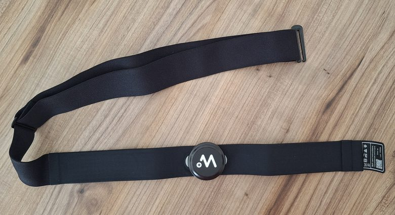

# chest-imu-cough-detection

Cough detection from a chest-worn motion sensor (IMU), without audio.

Cough monitoring usually relies on a microphone. In a classroom, a shared room,
or a bedroom at night, a microphone records other people and is often not
acceptable. A chest-worn accelerometer and gyroscope record body movement only,
so they can go where a microphone cannot.

**Activities, my recordings:** coughing (paced and natural), quiet sitting,
quiet standing, talking (with some laughing), throat clearing, walking, arm
movement.

**Activities, EPFL dataset:** coughing, laughing, throat clearing, deep
breathing, each while sitting and while walking.

  
   
  <em>The sensor I wore for this repository's own recordings: a Movesense sensor in a chest belt.</em>

  

Detection uses the accelerometer only. The features use both the
accelerometer and the gyroscope. The band is 10-80 Hz on my recordings and
10-45 Hz on EPFL, whose IMU runs at 100 Hz.

## What was found

In one line: cough-like movements are detected when coughs are sparse, but
they are not reliably told apart from laughing.

| | My recordings | EPFL cough dataset |
|---|---|---|
| Subjects | 1 (me), 7 seated sessions | 15 |
| Cough / not-cough label | what I was doing in each session | the recording's class (cough, laugh, throat clearing, deep breathing) |
| Independent cough labels | none; I wrote down counts while recording | coughs annotated from audio |
| Step 1, detector | counts match my notes: 8 for 8 coughs, 12 for 11 throat clears | finds 205 of 2,094 annotated coughs (10%); 205 of its 214 detections are real coughs |
| Step 2, classifier: cough or not? (AUC, 95% CI) | 0.832 [0.713, 0.986] | 0.765 [0.719, 0.803] |

**On my own recordings**

- While I was seated, the detector's counts match the ones I wrote down, and
  keep matching over a wide range of thresholds.
- Talking and laughing is the problem: 64% of the transients in that session
  are classified as coughs, against 33% for throat clearing and 0% for quiet
  sitting. In that session several large transients sit in double-peaked
  bursts up to 2.3 s long, while every seated cough is a single burst (five
  events, one session, one subject). I tested this on EPFL with a wider
  feature window: cough vs. laugh rises by about 0.06 AUC, but by the same
  amount without the burst-shape features, and every other confound rises too.
  On my own recordings the wider window moves the talking session the wrong
  way, from 64% to 86% called cough.

**On the EPFL dataset**

- Laughing and throat clearing are the confounds closest to coughing (AUC
  0.708 and 0.707 against coughs); deep breathing is the furthest (0.884).
- Recall is low. With the threshold placed on the background outside the
  annotated coughs, it rises from 10% to 27%. About half of the EPFL coughs
  never reach the detector's threshold of 8 MAD.
- Coughs there rise a median 7.5 MADs above the background, against 88 in my
  recordings. Most of that gap is a higher background on the EPFL recordings,
  not weaker coughs.

<b>More on the EPFL numbers</b>

**Threshold.** Under its own self-set threshold the detector finds 205 of
2,094 annotated coughs (recall 0.098), and 205 of its 214 detections are real
coughs. That number measured the port more than the method: the EPFL
recordings are about half coughing, which lifts the self-set threshold 1.74
times above the true background. With the threshold placed on the
background outside the annotations, recall is 0.270 at precision 0.956. That
uses the annotations to place the threshold, so it is a bound, not something
the detector can do without labels.

**Background vs. cough strength.** The 7.5 vs. 88 ratio alone does not say
which side differs, and the EPFL units cannot be calibrated. Measured against
walking, which needs no calibration, the coughs differ by a factor of about
1.5 to 2.5. So most of the gap is a higher background on the EPFL recordings,
not coughs ten times weaker. Walking differs between people, so this is an
order-of-magnitude check.

**Feature reference.** The 0.765 AUC uses the published feature reference.
How that reference is built moves the number: 0.874 [0.803, 0.924] with a
cough-free reference for cough recordings only, 0.719 [0.665, 0.777] with the
same rule for both classes. Neither alternative reference is clean, so that
check is inconclusive and 0.765 stays the reported figure.

## Limits

- One subject (me :) ) in this repository's own recordings; 15 in the EPFL data.
- All coughs are voluntary, recorded indoors, at one sensor position.
- The detector's recall on this repository's own protocol, against audio, has
  not been measured. The EPFL measurement comes from a different device,
  sampling rate and protocol.
- In this repository's own recordings the event labels come from the same
  accelerometer the classifier uses. Only the session identity is independent.
- Standing and walking are excluded. Standing needs a different threshold;
  walking cannot be counted with this detector.

## Reproducing

Requires Python 3.10 or later.

    pip install -e .

    # own recordings (included in data/sessions/)
    python scripts/audit_labels.py          # ends with 8/8 checks passed
    python scripts/run_analysis.py          # results/results.json
    python scripts/detector_sensitivity.py  # results/detector_sensitivity.json

    # EPFL dataset (downloaded, about 852 MB; audio deleted after extraction)
    python scripts/fetch_epfl.py
    python scripts/run_epfl.py              # results/epfl_results.json, about 4 minutes
    python scripts/threshold_placement.py   # results/threshold_placement.json, about 3 minutes
    python scripts/reference_checks.py      # results/reference_checks.json, about 2 minutes

    # burst shape: the talking-session lead and its test on EPFL
    python scripts/burst_shape.py           # results/burst_shape.json
    python scripts/shape_comparison.py      # results/shape_comparison.json, about 3 minutes

The last digit of some values may differ across scikit-learn versions.

<b>How the method works</b>

Two stages.

1. **Detection.** Transients are found on the accelerometer magnitude: band-pass
   filter, rectified and smoothed envelope, peaks above a threshold in
   median-absolute-deviations (MAD) of the recording's own envelope, with a
   refractory period between peaks.
2. **Classification.** Each detected transient is classified as cough or not
   by a random forest on band-energy, spectral-shape and duration features.
   Band energies are relative to the same recording's quiet background.

The label for stage 2 comes from what the subject was doing in that recording,
not from the signal. In this repository's own recordings stage 1 is not
independent ground truth: it uses the same accelerometer as stage 2. That is
why the label source matters, and why the EPFL audio annotations were used to
measure the detector.

Evaluation is leave-one-session-out on the single subject and
leave-one-subject-out on EPFL. The 95% interval resamples sessions or subjects,
not events, because events inside one recording are not independent. A
permutation null (labels shuffled) checks that the pipeline does not score by
chance.

Details: [docs/FINDINGS.md](docs/FINDINGS.md).

<b>The label audit</b>

The project's first labelling pass took its cough labels from peaks in the
same accelerometer signal it then classified. `scripts/audit_labels.py` checks
eight things about it. It found:

- Two of ten model features (zero-crossing rate on a magnitude signal) were
  identically zero.
- Merged events were labelled at the midpoint of two candidates, 1.13 to
  1.88 s apart, with a 0.5 s tolerance. The label landed where nothing
  happened, and the real events were left negative.
- Candidate times sat on a 0.18825 s grid: the detector reported a window
  position, not the peak.
- 22 of 43 confirmed events were at baseline noise.
- A peak detector matched the written-down counts while seated, not while
  standing or walking.
- The seated cough sessions were all recorded before the confound sessions,
  which is why features are normalised per session.

Details: [docs/LABEL_AUDIT.md](docs/LABEL_AUDIT.md).

<b>Detector constants and sensitivity</b>

Band 10-80 Hz, threshold 8 MAD, refractory period 1.0 s. They were set as
round values and checked, not tuned to the written-down counts.
`scripts/detector_sensitivity.py` sweeps each one.

On the seated recordings, the count is exactly 8 at every threshold from 8 to
25. Standing holds at 8 from threshold 11 upward, a higher range than seated,
so one global threshold does not serve both. Walking matches its written-down
count at a single threshold on the way down. Lowering the band's lower edge to
8 or 5 Hz breaks agreement.

On the EPFL data (band 10-45 Hz, because the IMU runs at 100 Hz) the count
does not hold: it falls at every threshold step.

The threshold is set from the recording's own background, which assumes
events occupy a small share of it. The EPFL cough recordings are about half
coughing, and the threshold lands 1.74 times above the true background.
Estimators that survive dense events also change the single-subject event
times, so the published estimator is kept.

Details: [docs/DETECTOR.md](docs/DETECTOR.md),
[docs/FINDINGS.md](docs/FINDINGS.md), [docs/CROSS_DATASET.md](docs/CROSS_DATASET.md).

<b>Cross-dataset results (EPFL, 15 subjects, seated)</b>

Published detector with a 10-45 Hz band. A detection hits a cough if it falls
within 0.2 s of an annotated cough. "Background from annotations" keeps the
detector and the threshold of 8 but takes the baseline and MAD from samples
outside annotated coughs: a bound on what the published threshold placement
costs, not a detector that runs without labels.

| subject | annotated coughs | recall, published | recall, background from annotations | cough peak, median background MADs | AUC, published reference |
|---|---|---|---|---|---|
| 14287 | 123 | 0.057 | 0.146 | 4.2 | 0.704 |
| 14342 | 113 | 0.053 | 0.177 | 6.5 | 0.914 |
| 14547 | 150 | 0.047 | 0.080 | 3.6 | 0.831 |
| 20794 | 72 | 0.167 | 0.375 | 10.6 | 0.698 |
| 38936 | 172 | 0.023 | 0.128 | 4.4 | 0.594 |
| 47779 | 155 | 0.000 | 0.200 | 6.1 | no detected coughs |
| 49661 | 120 | 0.375 | 0.583 | 19.0 | 0.739 |
| 55502 | 184 | 0.071 | 0.109 | 2.8 | 0.709 |
| 74768 | 148 | 0.054 | 0.264 | 6.9 | 0.739 |
| 76918 | 162 | 0.062 | 0.333 | 10.2 | 0.590 |
| 84479 | 141 | 0.078 | 0.376 | 10.2 | 0.890 |
| 86463 | 131 | 0.115 | 0.282 | 7.3 | 0.788 |
| 87369 | 122 | 0.270 | 0.434 | 15.1 | 0.691 |
| 87447 | 145 | 0.214 | 0.352 | 10.2 | 0.777 |
| 97706 | 156 | 0.019 | 0.378 | 12.5 | 0.904 |
| **pooled** | **2,094** | **0.098** (precision 0.958) | **0.270** (precision 0.956) | **7.5** | **0.765 [0.719, 0.803]** |

Per-subject AUCs rest on 3 to 45 cough transients each.

| | single subject | EPFL |
|---|---|---|
| AUC, 95% CI, published reference | 0.832 [0.713, 0.986], 7 sessions | 0.765 [0.719, 0.803], 15 subjects |
| AUC, 95% CI, annotation reference | not applicable | 0.874 [0.803, 0.924], asymmetric reference |
| AUC, 95% CI, symmetric reference | not applicable | 0.719 [0.665, 0.777], contaminated reference |
| least separated confound | talking and laughing | laugh and throat clearing |
| permutation null, mean | 0.499 | 0.491; 0.484 with the annotation reference |
| quiet-background check | 0.595 | 0.802; 0.662 annotation reference; 0.750 symmetric reference |
| cough peak, background MADs | median 87.6 | median 7.5 |
| cough peak / walking envelope | 6.8 | per-subject median 2.7 |

With the published reference the EPFL background check is not interpretable:
95% of its "quiet" windows in cough recordings overlap an annotated cough. The
annotation reference brings it to 0.662, not 0.5, because confound recordings
have no annotations and keep a detection-based reference. A symmetric
reference built without annotations gives 0.750, and 69% of its windows in
cough recordings overlap a cough.

Details: [docs/CROSS_DATASET.md](docs/CROSS_DATASET.md),
[docs/EPFL_DATASET.md](docs/EPFL_DATASET.md).

<b>Burst shape: a lead from the talking session</b>

A lead, not a result: five events, one session, one subject.

I measured how long the envelope stays above 3 MAD around each detected peak,
and how many detected peaks fall inside that stretch
(`scripts/burst_shape.py`). All 43 seated coughs are single-peaked bursts. The
17 natural ones last 0.67 to 1.49 s, median 1.07 s. In the talking session,
the five transients at 50 MAD or more last 0.42, 1.03, 1.69, 1.90 and 2.30 s,
and the three longest each hold two detected peaks. These numbers are on the
detector's own MAD scale. On the background scale used for peak heights, eight
transients reach 50 MAD, and one cough lasts 2.04 s, longer than three of the
five double-peaked talking bursts. Talking and laughing share the session, so
whether the double-peaked bursts are laughs is a hypothesis.

The test (`scripts/shape_comparison.py`): the published features plus burst
duration, peaks in the burst, the interval between them and burst duration
over half-height width, over the published window (0.4 / 0.6 s) and two wider
ones. On EPFL, where laugh is its own class:

| configuration | cough vs. laugh | cough vs. throat clearing | cough vs. deep breathing | overall |
|---|---|---|---|---|
| published, 0.4 / 0.6 s | 0.708 | 0.707 | 0.884 | 0.765 |
| published features, 0.5 / 2.0 s | 0.766 | 0.730 | 0.911 | 0.799 |
| with burst shape, 0.4 / 0.6 s | 0.701 | 0.735 | 0.903 | 0.781 |
| with burst shape, 0.5 / 2.0 s | 0.766 | 0.763 | 0.921 | 0.815 |
| with burst shape, 1.0 / 2.5 s | 0.765 | 0.765 | 0.921 | 0.816 |

The rule, fixed before the run, asked for cough vs. laugh to rise beyond
chance and by more than cough vs. deep breathing. It gave mixed: the first
holds in one window, at the edge, and the second in none. The gain comes from
the wider window, not from the shape features. On EPFL the shape features see
no trains: cough and laugh bursts both last a median 0.24 s, and none holds a
second detected peak. So this test neither confirms nor rules out the
double-peak idea. The feature set stays as published.

Details: [docs/FINDINGS.md](docs/FINDINGS.md#burst-shape-in-the-talking-session),
[docs/CROSS_DATASET.md](docs/CROSS_DATASET.md#burst-shape-and-a-wider-window).

<b>The dataset</b>

`data/sessions/` holds 12 sessions of about two minutes each, recorded on
myself with a chest-worn Movesense sensor, using
[movesense-ecg-hrv-dashboard](https://github.com/sumeyye-agac/movesense-ecg-hrv-dashboard).
Each session is a ZIP with `imu.csv` (accelerometer, gyroscope, magnetometer;
subscribed at 208 Hz, delivered at about 216 Hz), `meta.json` and a
per-capture `README.md`.

ECG, heart rate, RR intervals and temperature were also recorded but are not
published. The metadata still describes those streams, as a record of what was
recorded. The published recordings carry no device identifier.

| session | activity |
|---|---|
| `cough_metronomic_01`, `_02` | paced coughing, seated |
| `cough_natural_01_sitting`, `_02_sitting` | natural coughing, seated |
| `cough_natural_03_standing` | natural coughing, standing |
| `cough_natural_04_walking` | natural coughing, walking |
| `baseline_calm_01_sitting` | quiet sitting |
| `baseline_calm_02_standing` | quiet standing |
| `baseline_confound_01_talking` | talking, with some laughing in between, seated |
| `baseline_confound_02_throatclear` | throat clearing, seated |
| `baseline_movement_01_walking` | walking |
| `baseline_movement_02_reaching` | arm movement |

`data/legacy_labels/` holds the labels and model from the first labelling
pass, kept as the subject of the audit.

The EPFL dataset is not in this repository. `scripts/fetch_epfl.py` downloads
it into `data/external/` (gitignored) and keeps only the IMU and the labels.

## Data policy

The 12 adult recordings are included. Pediatric recordings are never included
in any form. This is not a clinical tool. See
[docs/DATA_POLICY.md](docs/DATA_POLICY.md).

## License

MIT. See [LICENSE](LICENSE).

## References

- Cough-E (EPFL): arXiv:2410.24066. https://arxiv.org/abs/2410.24066
- NC State OOD-Multimodal-CoughDet dataset: Dryad, DOI 10.5061/dryad.mkkwh717r.
  https://doi.org/10.5061/dryad.mkkwh717r
- EPFL edge-AI cough dataset: L. Orlandic et al., "A Multimodal Dataset for
  Automatic Edge-AI Cough Detection", IEEE EMBC 2023,
  doi:10.1109/EMBC40787.2023.10340413. Data: Zenodo 7562332,
  https://zenodo.org/records/7562332, licensed CC-BY 4.0. Used here unmodified
  apart from deleting the audio files after download; not redistributed.
